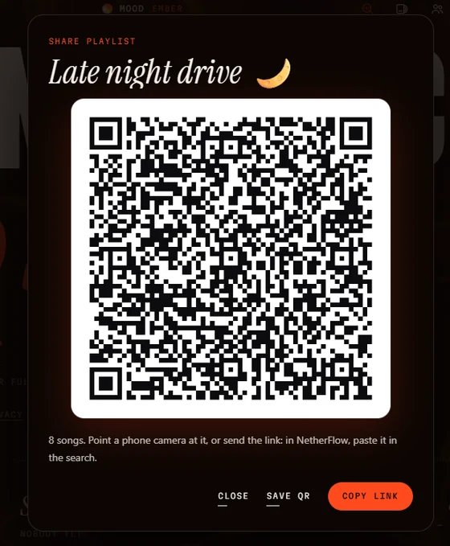
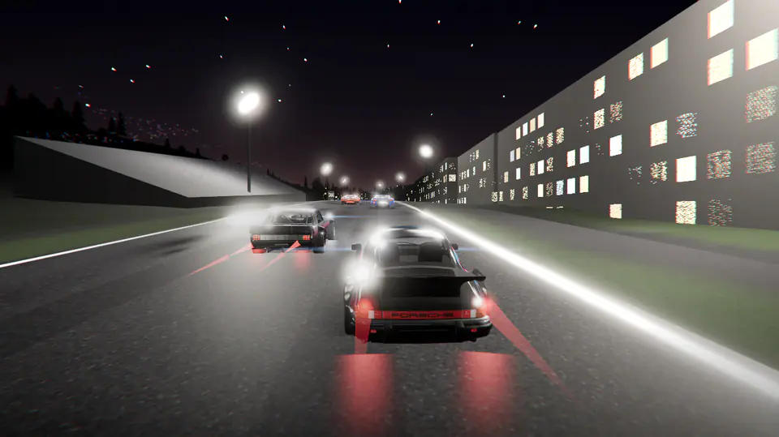

# Changelog

What changed in each NetherFlow release. The builds are on the [releases page](https://github.com/volodya-rua/NetherFlow/releases).

## 1.6.4: Fix · playlist covers, the play button, and a lighter Glass

- **Playlist covers:** a playlist's own picture no longer stays blank while its songs show their covers. An image server
  turned some covers down, and the app then left that server alone for a while; covers are now asked for without the
  app's own address going with them. A cover that doesn't come is asked for again, at its other sizes, and one that
  never comes shows a plain square in the theme's colours instead of an empty box. A playlist's picture also fills in
  as an import brings its songs' covers
- **The play button:** a song whose cover is a video's picture now fills the round play button, not a small square in
  the middle of it
- **Lighter glass** (Settings, with the Glass theme on): fewer glass effects and the background drawn half as often, for
  a smoother app on a slower device. Off to start with: Glass in full
- **Hide controls:** Off, Full screen (to start with) or On (to start with on a TV)
- **Glass on a computer:** the library, search, an artist's page and About take less work for the graphics chip to draw
  (the blur behind them isn't drawn again every frame)

## 1.6.3: Glass, 19 new lyric fonts, and controls that get out of the way

- **Glass:** a new theme (the seventh on a computer, the sixth on a phone). On a computer the header's buttons are clear
  drops of glass that bend the light behind them, and the player's rim bends it too: what's under them magnified,
  curving round their edges with a thin rainbow, and Settings and the menus are glass panels with an edge that bends
  what's behind them.
  On phones they're frosted glass, and on a powerful phone at High or Ultra quality the controls bend the light too.
  It has its own scene of light through rippled glass, its own typefaces (Libre Bodoni and Cormorant Garamond) and two
  lyric looks of its own, Prism and Frost. Settings › Glass picks Auto, Frosted, Tinted or Solid
- **19 new lyric font pairs:** Voxel, Hype, Glaze, Foil, Groove, Epic, Rodeo, Waltz, Bounce, Varsity, Marquee, Gummy,
  Boom, Letter, Laser, Disco, Deco, Haunt and Brush, 32 in all
- **Lyrics in your script:** lyrics in Hindi, Marathi, Bengali, Punjabi, Gujarati, Tamil, Telugu, Kannada, Malayalam,
  Arabic and Urdu get typefaces of their own, on phones too
- **Hide controls** (Settings › Hide controls): while a song plays, the header, the timeline and the buttons fade away
  after a few seconds, leaving a thin line for how far the song's got. A touch, the mouse, a key or the remote brings
  them back. Off unless you turn it on, and on to start with on a TV
- **Count me once:** a box in "Before you press play" that adds 1 to a public count of installs, with nothing about
  you. It's ticked in NetherFlow's own releases and unticked in Android builds made by others; untick it to skip it.
  The Terms and Privacy text now say how it works, so you'll be asked to agree once more
- **Fixed:** the playing song's cover shows again on PC, by the title and on the play button's record. Lens lyrics
  glide smoothly on phones and come back right after the home screen. A TV remote reaches Count me once, and comes
  back to the setting just picked. Some Android TVs no longer open to a black screen now and then. Drive mode fits on
  phone screens at large text sizes too, and keeps right-to-left names whole

## 1.6.2: Voice control, Android Auto, a visualiser, and lyrics you can read

- **Voice control:** say a song, an artist or what to do ("next", "pause", "volume 40"). On Android it uses the phone's
  own speech recognition. On Windows it uses Windows' own, or the optional voice pack: Whisper, running on your
  computer, so names and accents are heard better
- **"Hey NetherFlow"** (Windows, with the voice pack): hands-free, off unless you turn it on, and paused when you click
  the glowing mic or say "stop listening"
- **In the car:** Android Auto, music that doesn't break when the car connects, Drive mode coming up by itself, and
  NetherFlow starting by itself when Android Auto connects (with "Display over other apps", your choice). Android Auto
  shows NetherFlow once you turn on Unknown sources in its developer settings. **Road trip:** a playlist for the drive
  that keeps playing without signal
- **Visualiser:** a third view beside Lyrics and Cover, the whole screen moving with the music, in eight looks
- **Lyrics you can read:** eight new styles where every word stays big and clear and the word being sung sits on a
  block of the mood's colour: Tower, Lens, Pop (with emoji popping in by the words), Drift, Wall, Fisheye, Fisheye
  Emoji and Emoji Stack. Tamil, Hindi, Punjabi, Telugu and other scripts no longer fall apart in the letter-by-letter
  styles
- **Light round your screen:** seven new looks for the beat on the screen's edges, among them Trace (one long arc of
  light gliding round the screen in the album's colour) and Rim (a soft glow flowing round the edges, with the music or
  still, in your own colours if you like), plus Frame, Dots, Aurora, Spikes and Ripple
- **Make it yours:** your own pictures as the background (kept on this device only, with dim and blur), your own colours
  for the lyrics, the highlight and the rest, 14 more moods and 9 more backgrounds (Apollonian, Newton, Coral,
  Mandelbrot, Vortex, Deep Field, Ridges, Rosette and Moiré)
- **360 sound, rebuilt:** the song split into 512 bands and set round you; 360 Orbit uses the browser's own 3D hearing
- **Sing:** at 0% the voice is now taken out frequency by frequency, its reverb too. On Windows, AI karaoke takes the
  singer out with an AI built into the app, on your computer
- **Shuffle** plays every song of a list once before any song comes round again, even when you tap another song or close
  the app. A song tapped in the middle of a playlist plays the songs above it too, after the last one
- **Repeat a part:** the song's ⋯ › Repeat a part, then Start and End as it plays
- **Offline:** when the internet drops, the list carries on with the songs saved on this device, shuffled or in order
- **Bring your music:** scan a QR code holding a Spotify, Apple Music or YouTube Music link, or a playlist shared from
  NetherFlow; or bring everything over from your own Spotify data download. Big playlists show how far they've got
- **Share and play together:** a playlist's short link and QR code, kept encrypted on NetherFlow's relay so only people
  with the link can read it; Listen together and Sync with your phone by QR code too
- **Smart playlists** that fill themselves, and **Autoplay** held to the song you chose, learning from what you skip
- **MobiVib** (Android): the phone vibrates with the music. **Sound › Quality:** Best, Normal or Data saver
- **Quicker:** covers you've already seen show at once when you open NetherFlow again, and the start is faster
- **Easier:** Settings in Classic (the few most people change) or Advanced (every one), Back atop every panel, and a back
  arrow beside the logo on the song's page
- **A new icon,** and **Credits** in About for the active testers who helped make NetherFlow better
- **Steadier:** the music keeps playing when the sound engine dies or a song won't load, far fewer "couldn't load"
  skips, and a song tapped in search plays that song, then Autoplay
- NetherFlow's data is no longer included in Android's Google Drive backup: it stays on your phone (use Phone ↔ PC sync
  to move your library)
- The terms and privacy policy changed (voice control, the camera for QR codes, in the car, AI karaoke, short share
  links, and the covers, pictures and list kept on your device), so you're asked to accept them again

## 1.6.1: Your computer's name stays private while syncing

- **Phone ↔ PC sync:** while the sync is open, any device on your Wi-Fi that asks who's there only hears "your computer",
  never the computer's own name (often its owner's). Your phone says "Syncing with your computer", and the computer's
  Sync panel still shows its name to you

## 1.6.0: Play on a TV or speaker, live concerts, and Listen together for 30

- **Play on a TV or speaker.** It works with Chromecast and other Google Cast devices, and with DLNA TVs and speakers.
  NetherFlow isn't made, certified or endorsed by Google. The TV or speaker fetches the song itself; play, pause,
  moving through the song and the volume work from NetherFlow, on computers and phones
- **NetherFlow also runs on Fire TV: install the APK.** Phones and computers on your Wi-Fi can then play on it, as on
  any Android TV or Google TV. Settings › "Let phones and computers on this Wi-Fi play here" turns it off
- **Live concerts from the Internet Archive's Live Music Archive:** free shows, most of them taped by fans, in Library ›
  Live concerts and with the artists you search for, each with its own page there
- **Weekly picks** (songs new to you, like the ones you love, new every Monday) and **Today's mix**
- **Listen together** with up to 30 people
- **Romanized lyrics** in Hindi, Punjabi and India's other scripts, the line coming next too, and word-by-word lyrics
  in those scripts
- **Share to NetherFlow** (Android): a song shared from YouTube or YouTube Music plays that very song (a music video's
  song as its album recording)
- **The island** (Windows) can be moved: Settings › Island position, or Ctrl+Alt+I from any app
- **Update notices:** a system notification when a newer NetherFlow is out
- **Phones:** the music keeps playing when Android takes the app's page away, and a song that stuck picks up again;
  jumping ahead past what's loaded now works
- **Steadier and lighter:** a long list stays where it was while songs download; rows are built twice as fast; songs scrolled
  past aren't looked up for lyrics; the island rests while paused; Smooth mix checks once a second until a song's end
- **Fixes:** a song with no timed lyrics shows its cover; no "1.8B views" as a shared video's album; a junk lyrics entry
  no longer cuts word-by-word lyrics to one line; headphone correction at 0% is kept after a restart
- The built-in server on computers turns away requests from web pages in a browser
- The terms and privacy policy changed a little (TVs and speakers, NetherFlow on a TV, live concerts and update notices),
  so you're asked to accept them again

## 1.5.1: Better search, playlists you can arrange, and a booster up to 300%

- **Search** works like the big music apps: All, Songs, Artists and Albums at the top, the top result beside the first
  four songs, and artists and albums in rows. The page is there in under a second, and an artist's full list fills in
  as you look. A song from the search starts without a second search of its own
- **Playlists:** find a song in one as you type; sort by title, artist, newest added or length; Edit order to drag songs
  (or move them with the arrow keys); and Add songs from the playlist itself. On a phone, a playlist's buttons sit across
  under its name
- **Songs start sooner:** about 0.7 s less wait on a first play, and the artist's own upload is preferred even when
  YouTube Music doesn't answer
- **Covers** in long lists load faster, and one that won't load is tried another way
- **Lyrics in sync on rap songs:** word-by-word timing that's out of line with the song is lined up again, and words with
  no timing follow the song's own pace
- **A volume booster up to 300%,** through a new limiter, so it stays loud without clipping, the bass and treble as they
  were (and a note to go easy on your ears)
- **360 sound** keeps the bass as it is and no longer muddies the low-mids
- **Play on** (computers): pick the speakers or headphones it plays on
- **Interface size** (Settings): everything larger or smaller, 80–150% on computers and 100–150% on phones
- **Beat on the screen edges:** four looks (Wave, Bars, Neon, Glow) and four sizes
- **Esc twice** (computers) goes to the home screen, as Back does on a phone
- **No freeze when picking Redline:** the 3D race runs on its own, and Extreme lyrics turn on without a pause
- No glow follows the cursor any more; Settings › Update always shows the version; lyrics not timed to the song are an
  even column to read; on phones the Cover view keeps the next line clear of the timeline

## 1.5.0: NetherFlow's own player, and a much smaller app

- **Sound tools** in the Equalizer panel: Crossfeed for headphones, Clarity, Loudness at low volume and Night mode, plus
  360 sound (Around and Orbit). A "Playing now" line says the format and quality of what's playing
- **Gapless albums:** the next track of the same album starts the moment this one ends
- **Shuffle:** a toggle next to Repeat, and a Shuffle button beside Play all on playlists, Liked songs, mixes, artists
  and albums. Every song plays once, Back goes to the one before, and podcasts and audiobooks stay in order
- **Radio** from any song or artist: songs like it, without end
- **A mix for the time of day** in Explore (Morning, Afternoon, Evening, Late night), from what you play at that time
- **Follow artists:** their new releases first in Explore, and a note when they're out
- **Mix with a friend:** your taste as a link. A friend's opens as a mix of you both, the songs you both love first
- **Android Auto:** liked songs, recent plays and playlists on the car's screen, and voice search. NetherFlow has to be
  open on the phone, and Android Auto lists apps from outside the Play Store only with its Unknown sources developer
  setting on
- **A 10-band equalizer**, two more 360 modes, a strength setting for headphone correction, and a softer volume booster
- **Romanized lyrics** (Settings): sing along in Latin letters, worked out on your device
- **Word-by-word lyrics for more songs**, from the open AMLL lyrics database too, and smooth even where the timing is
  uneven
- **Carry on where you left off:** the last song is there when the app opens, and Play picks it up at the same moment
- **A new cursor** on computers: a glowing arrow in the mood's colours, with a ring that glides after it

- **Songs start right away, and the next one's already there when you skip.** NetherFlow plays through its own player
  now, FlowStream, in place of a hidden YouTube player: every song in the best sound YouTube has (usually Opus; a few songs only exist as AAC), and no hidden
  video running down your battery
- **The music video behind the lyrics** (Extreme lyrics, on computers) is sized to your screen and drops to 30 fps on
  battery
- **Saving for offline goes through FlowStream too:** the same best sound, a song saved in about 2 seconds
- **A much smaller app:** NetherFlow no longer carries yt-dlp (or, on Android, a whole Python to run it): the phone
  app is about 7 MB instead of 41, the Windows one about 17 MB lighter
- **The songs you played last start instantly:** their first moments are kept on your device (Settings › Instant start,
  where you can also clear them)
- **The right version of a song:** a remix finds the remix, a live take the live one, and the artist's own upload is
  preferred. Imported playlists keep each song's version too
- **Lyrics show much sooner:** the synced lines appear as soon as they're found, and the word-by-word timing takes over
  when it arrives
- **A quicker start**, a cleaner Android splash screen, and backgrounds drawn without holding the app up
- **Smooth even on long playlists**, and the Redline races load without holding the app up
- **Imports:** every song of a playlist is in at once, ready to play; a playlist imported again opens straight away;
  long playlists read faster
- **Offline:** a song that isn't saved gives way to the next one that is, and says so. Offline saves carry on after the app
  closes, and resume when the internet comes back
- **Playlists you edit together** connect faster and stay connected
- YouTube Music's lyrics say who they come from
- A song that won't load is tried a few ways, then skipped with a note saying which, so the music doesn't stop
- When the lyrics site is busy, NetherFlow says so and tries again, rather than saying there are no lyrics
- The quality line shows each song's real bitrate

- **Every screen works with the remote.** Move songs in the queue (OK on a song's handle, then up and down), read the
  terms, and use the QR code, Rename and artist pages over the Library. Back always closes the screen on top
- **The TV home's title** no longer runs into the header
- **Easier on the eyes:** the lyric looks that flash do it at most twice a second, never when your system asks for less
  motion, and NetherFlow tells you the first time
- **Listen together and shared playlists go through NetherFlow's own relay now**: it keeps no logs and, as before, can't
  read anything (it's all end-to-end encrypted). The public relays stay as a backup for a while
- Heads-up: someone on 1.4.2 or older can't join a Listen together session started on 1.5.0, so update both sides.
  Shared playlists keep working with older versions
- The terms and privacy policy changed a little (which country's law applies, a note on flashing light, and the new
  relay), so you're asked to accept them again

**Fixes**

- A song liked, or a playlist opened from a link, in the first moments after the app starts is no longer lost
- The equalizer's top bands can be dragged again
- Mixes no longer list the same song twice
- Searching podcasts and audiobooks: a slow earlier search no longer replaces the results of a newer one
- Artist and album pages say when they couldn't load, rather than showing no songs
- The lyric video comes back by itself after the graphics card resets
- Stories, and the stats and playlist pictures, are made without freezing the phone
- Android: a cover that never arrives no longer holds the notification up, a podcast download stopped earlier no longer
  stops the next one, and the app no longer closes when the notification can't restart
- The update check tries again at the next start when it couldn't reach GitHub

## 1.4.2: Listen together and sync, locked down tighter

- **Codes nobody can work out.** Listen together codes are 9 characters now and phone ↔ PC sync codes 12 numbers, made so
  that someone watching the relay or your Wi-Fi would need years to guess them
- **Listen together finds your friends more reliably**: if a relay is flaky for one of you, NetherFlow tries the others,
  and nobody gets stuck paused on the first song
- Heads-up: 1.4.1 and 1.4.2 can't Listen together or sync with each other, so update both sides

## 1.4.1: Tactical got its own crew

- **Six agents of its own** in the Tactical theme: Vanta, Onyx, Kestrel, Solstice, Halcyon and Tempest, drawn by the app
  itself. Pick your favourite in Settings, or get a different one every song
- Nothing gets fetched from anywhere for the theme anymore

## 1.4: Podcasts, audiobooks, Explore, playlists you make together, Linux and your TV

- **Podcasts.** Shows from Apple's podcast directory, plus your country's top 50. Follow a show and its new episodes
  show up for you. It picks up where you left off, plays at 0.8× to 2×, and you can **save episodes for offline**
- **Audiobooks.** Thousands of free classics read by LibriVox's volunteers (Sherlock Holmes, Moby Dick, Jane Austen…),
  chapter by chapter, from where you stopped
- **Explore.** Your country's charts, fresh albums and singles, what's trending, and every mood and genre with its
  playlists. Plus **Your mix** and **Discover**, made from what you actually play (and Discover only has songs you haven't
  heard), and **New from artists you play**
- **Playlists you make together.** Hit *Edit together*, send the link, and everyone who opens it can add, remove and rename,
  live, on any phone or PC. No account, and it's end-to-end encrypted
- **Headphone correction.** Pick your headphones (6,000+ models, from AutoEQ) and the equalizer evens out their sound
- **Linux.** A .deb and an AppImage, same app, same everything
- **Android TV and Google TV.** It's on your TV's home screen, and the whole app works with the remote: the arrows go from
  thing to thing, OK presses, Back goes back. Runs on 32-bit TV boxes too (Chromecast with Google TV, Fire TV…)
- **A new license: GPL v3.** Still free and open source. Changed versions have to stay open source too, keep the credit,
  and use a name and logo of their own ([details](#license)). 1.3.1 and earlier stay under MIT

## 1.3.1: Playlists of any length, and many fixes

- **Import as big as you want.** A 10,000-song Spotify playlist comes in whole. Short links too. Import the same one again
  later and it just adds what's new, no second copy
- **Taking a song out of the queue doesn't touch your playlist anymore** (it used to delete it from there)
- A song that won't load gets retried, then skipped, and **Autoplay keeps the music going** even when YouTube hiccups
- Search in **Hindi, Arabic, Korean or Chinese** and you get the original, not the covers
- Fits **small laptops**, **phones sideways** and **big text sizes**, and works with just a **keyboard** (Tab, Space, Enter)

## 1.3: Share playlists with a QR code

Open any playlist and tap **Share** for its QR code. Your friend points their phone camera at it and sees the
whole playlist. Then they paste the link in NetherFlow's search and it's theirs. Or just send the link.

- **Nothing gets uploaded.** The songs ride inside the link itself, no server, no account
- **Save QR** makes a card with the code on it, ready for your story or the group chat
- Works for **Liked songs** too
- The QR code on the right is a real one: scan it

 

## 1.2: Redline's 3D races

  

- **Redline got real 3D races.** On famous circuits, built from real map data with the real hills, buildings,
  grandstands with crowds, barriers and forests. Five supercars race each other all on their own: braking for every
  corner, slipstreaming, overtaking side by side, one of them drifting in its own smoke. It's filmed like a TV
  broadcast and cut on the beat. In a build-up the start lights come on one by one, and when the chorus drops they go
  out and the whole field blasts under the gantry in slow-mo. Windows, on Extreme+
- **Music videos are smooth now.** Behind Extreme lyrics the song's official video plays straight through, in sync with
  the song. No more jumpy cuts
- **It never freezes.** As long as NetherFlow is on your screen it keeps moving, even with another window on top
- **NetherFlow Lite** for Windows, and **Settings › 3D race** with a *Load now* button
