<p align="center">
  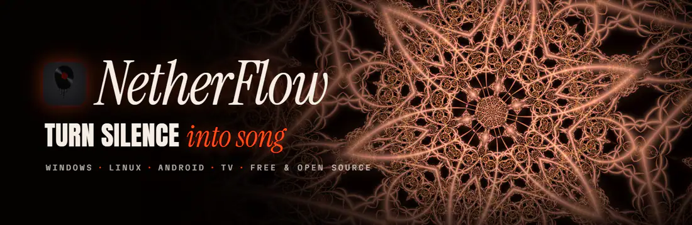
</p>

<p align="center">
  <a href="https://github.com/volodya-rua/NetherFlow/releases/latest"></a>
  
  
  <a href="LICENSE"></a>
  <br>
  <a href="#hucla"></a>
  <a href="https://www.instagram.com/volodya.rua/"></a>
</p>

<h3 align="center">yo, this is NetherFlow 🎧</h3>

<p align="center">
  A free music player for Windows, Linux, Android and Android TV that turns any song into a whole vibe.<br>
  Full songs, lyrics hitting word by word, and backgrounds that actually move with the music. Podcasts and audiobooks too.<br>
  No account, no ads of its own, no analytics. Just you and the song.
</p>

<p align="center">
  <a href="#get-it"><b>Get it</b></a> ·
  <a href="#whats-new">What's new</a> ·
  <a href="#themes">Themes</a> ·
  <a href="#backgrounds">Backgrounds</a> ·
  <a href="#features">Features</a> ·
  <a href="#vs">vs Spotify &amp; co</a> ·
  <a href="#hucla">HuCla</a> ·
  <a href="#hit-me-up">Hit me up</a>
</p>

<br>

<a id="get-it"></a>

## ⬇️ Get it

Grab it from the **[latest release](https://github.com/volodya-rua/NetherFlow/releases/latest)**. It's free.

| | Installer | Portable |
|:--|:--|:--|
| ⭐ **Windows Lite**<br><sub>recommended</sub> | `NetherFlow-Lite-Setup-<version>.exe`<br><sub>installs just for you (no admin), shortcuts, uninstaller, and it updates itself</sub> | `NetherFlow-Lite-<version>-Windows.exe`<br><sub>just run it, nothing to install</sub> |
| 🏎️ **Windows** | `NetherFlow-Setup-<version>.exe` | `NetherFlow-<version>-Windows.exe` |
| 🐧 **Linux** (64-bit) | `NetherFlow-<version>-amd64.deb`<br><sub>Ubuntu, Debian, Mint, Pop!_OS and the like</sub> | `NetherFlow-<version>-x86_64.AppImage`<br><sub>any distro; it updates itself. Ubuntu 24.04 and newer don't let it use Chromium's sandbox, so it runs without; the .deb keeps it</sub> |
| 🤖 **Android** 7.0+<br>📺 **Android TV**, Google TV | `NetherFlow-<version>.apk` | <sub>the same app: on a TV it's worked with the remote</sub> |

**On Windows and not sure? Get Lite.** It's the exact same app minus Extreme+ (so no Redline races or cars, which need a beefy graphics
card anyway), about 18 MB smaller, and it updates to Lite.

<a id="whats-new"></a>

## 🔥 What's new

### 📺 1.4.3: the whole app on your TV's remote

- **Songs start right away, and the next one's already there when you skip.** NetherFlow plays through its own player
  now, FlowStream, in place of a hidden YouTube player: every song in the best sound YouTube has (Opus), and no hidden
  video running down your battery
- **The music video behind the lyrics** (Extreme lyrics, on computers) is sized to your screen and drops to 30 fps on
  battery
- **Saving for offline goes through FlowStream too:** the same best sound, a song saved in about 2 seconds, and yt-dlp
  takes over if FlowStream can't get it
- YouTube Music's lyrics say who they come from
- A song that won't load is tried a few ways, then skipped with a note saying which, so the music doesn't stop

- **Every screen works with the remote.** Move songs in the queue (OK on a song's handle, then up and down), read the
  terms, and use the QR code, Rename and artist pages over the Library. Back always closes the screen on top
- **The TV home's title** no longer runs into the header
- **Easier on the eyes:** the lyric looks that flash do it at most twice a second, never when your system asks for less
  motion, and NetherFlow tells you the first time
- **Listen together and shared playlists go through NetherFlow's own relay now**: it keeps no logs and, as before, can't
  read anything (it's all end-to-end encrypted). The public relays stay as a backup for a while
- Heads-up: someone on 1.4.2 or older can't join a Listen together session started on 1.4.3, so update both sides.
  Shared playlists keep working with older versions
- The terms and privacy policy changed a little (which country's law applies, a note on flashing light, and the new
  relay), so you're asked to accept them again

### 🔐 1.4.2: Listen together and sync, locked down tighter

- **Codes nobody can work out.** Listen together codes are 9 characters now and phone ↔ PC sync codes 12 numbers, made so
  that someone watching the relay or your Wi-Fi would need years to guess them
- **Listen together finds your friends more reliably**: if a relay is flaky for one of you, NetherFlow tries the others,
  and nobody gets stuck paused on the first song
- Heads-up: 1.4.1 and 1.4.2 can't Listen together or sync with each other, so update both sides

### 🎯 1.4.1: Tactical got its own crew

- **Six agents of its own** in the Tactical theme: Vanta, Onyx, Kestrel, Solstice, Halcyon and Tempest, drawn by the app
  itself. Pick your favourite in Settings, or get a different one every song
- Nothing gets fetched from anywhere for the theme anymore

### 🎙️ 1.4: podcasts, audiobooks, Explore, playlists you make together, Linux and your TV

- **Podcasts.** Every show in Apple's podcast directory, plus your country's top 50. Follow a show and its new episodes
  show up for you. It picks up where you left off, plays at 0.8× to 2×, and you can **save episodes for offline**
- **Audiobooks.** Thousands of free classics read by LibriVox's volunteers (Sherlock Holmes, Moby Dick, Jane Austen…),
  chapter by chapter, from where you stopped
- **Explore.** Your country's charts, fresh albums and singles, what's trending, and every mood and genre with its
  playlists. Plus **Your mix** and **Discover**, made from what you actually play (and Discover only has songs you haven't
  heard), and **New from artists you play**
- **Playlists you make together.** Hit *Edit together*, send the link, and everyone who opens it can add, remove and rename,
  live, on any phone or PC. No account, and it's end-to-end encrypted
- **Headphone correction.** Pick your headphones (6,000+ models, from AutoEQ) and the equalizer evens out their sound
- **Linux.** A .deb and an AppImage, same app, same everything
- **Android TV and Google TV.** It's on your TV's home screen, and the whole app works with the remote: the arrows go from
  thing to thing, OK presses, Back goes back. Runs on 32-bit TV boxes too (Chromecast with Google TV, Fire TV…)
- **A new license: GPL v3.** Still free and open source. Changed versions have to stay open source too, keep the credit,
  and use a name and logo of their own ([details](#license)). 1.3.1 and earlier stay under MIT

### 🛠️ 1.3.1: playlists of any length, and a ton of fixes

- **Import as big as you want.** That 10,000-song Spotify playlist? All of it. Short links too. Import the same one again
  later and it just adds what's new, no second copy
- **Taking a song out of the queue doesn't touch your playlist anymore** (it used to quietly delete it from there 😬)
- A song that won't load gets retried, then skipped, and **Autoplay keeps the music going** even when YouTube hiccups
- Search in **Hindi, Arabic, Korean or Chinese** and you get the original, not the covers
- Fits **small laptops**, **phones sideways** and **big text sizes**, and works with just a **keyboard** (Tab, Space, Enter)

### 📲 1.3: share playlists with a QR code

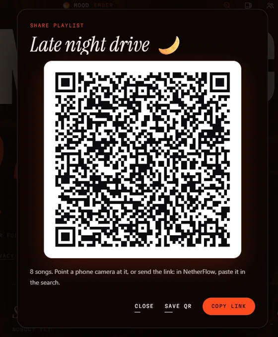

Open any playlist, hit **Share**, and boom, there's a QR code. Your friend points their phone camera at it and sees the
whole playlist. Then they paste the link in NetherFlow's search and it's theirs. Or just send the link.

- **Nothing gets uploaded.** The songs ride inside the link itself, no server, no account
- **Save QR** makes a card with the code on it, ready for your story or the group chat
- Works for **Liked songs** too
- Go on, scan the one on the right 👉 it's a real one

<br clear="right">

### 🏁 1.2: Redline's 3D races

<p align="center">
  
</p>

- **Redline got real 3D races.** On famous circuits, built from real map data with the real hills, buildings,
  grandstands with crowds, barriers and forests. Five supercars race each other all on their own: braking for every
  corner, slipstreaming, overtaking side by side, one of them drifting in its own smoke. And see, it's filmed like a TV
  broadcast and cut on the beat. In a build-up the start lights come on one by one, and when the chorus drops they go
  out and the whole field blasts under the gantry in slow-mo. Windows, on Extreme+
- **Music videos are smooth now.** Behind Extreme lyrics the song's official video plays straight through, in sync with
  the song. No more jumpy cuts
- **It never freezes.** As long as NetherFlow is on your screen it keeps moving, even with another window on top
- **NetherFlow Lite** for Windows, and **Settings › 3D race** with a *Load now* button

<a id="themes"></a>

## 🎨 Themes

One tap and the whole app changes: every button, the colours, the fonts, the cursor, the timeline, the background,
even how the lyrics come in. Six of them (five on Android).

<table>
  <tr>
    <td width="33%" valign="top">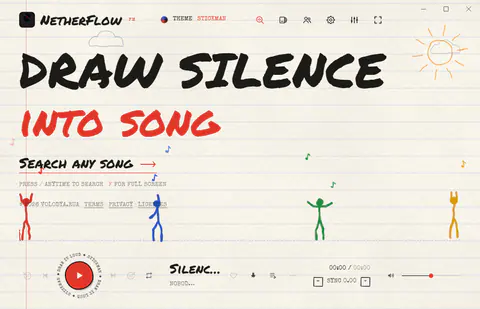<br><b>Stickman</b><br><sub>notebook paper and ink, stick figures dancing to the beat</sub></td>
    <td width="33%" valign="top">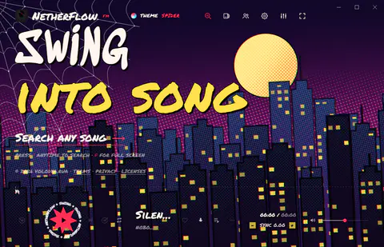<br><b>Spider</b><br><sub>a comic book at night, a masked hero swinging through the city, POW and WHAM on the beat</sub></td>
    <td width="33%" valign="top">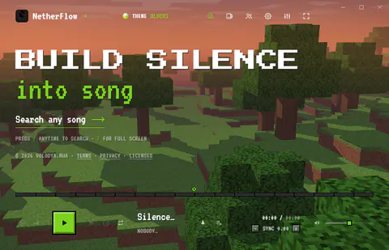<br><b>Blocks</b><br><sub>a blocky world at dusk to fly over, stone buttons, an XP bar</sub></td>
  </tr>
  <tr>
    <td width="33%" valign="top">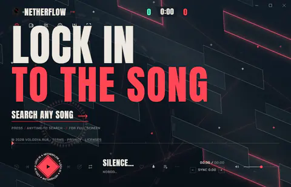<br><b>Tactical</b><br><sub>one of six agents of its own next to the lyrics, a round timer, ACE and CLUTCH banners</sub></td>
    <td width="33%" valign="top">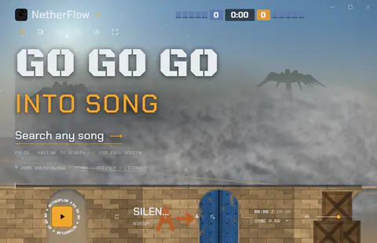<br><b>Ops</b><br><sub>a desert bomb site, smoke and tracers on the kick, the lyrics as a kill feed</sub></td>
    <td width="33%" valign="top">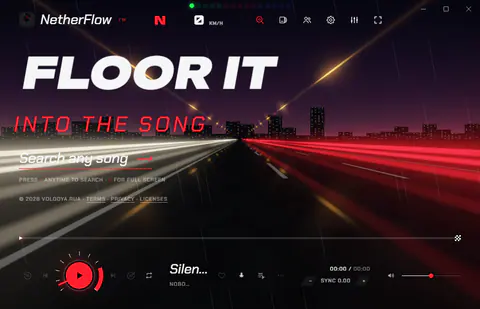<br><b>Redline</b> <sub>· Windows, Extreme+</sub><br><sub>real cars on real circuits in 3D, a rev counter round the play button</sub></td>
  </tr>
</table>

<a id="backgrounds"></a>

## 🌌 Backgrounds

27 of them, and they take their colours straight from the album cover. Smoke, northern lights, liquid colour,
starfields, galaxies, kaleidoscopes, fractals and more. These are a few of my favourites:

<table>
  <tr>
    <td width="33%"><br><b>Smoke</b></td>
    <td width="33%">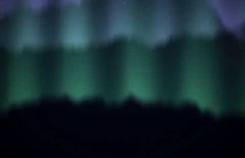<br><b>Aurora</b></td>
    <td width="33%"><br><b>Liquid</b></td>
  </tr>
  <tr>
    <td width="33%"><br><b>Cosmos</b></td>
    <td width="33%"><br><b>Galaxy</b></td>
    <td width="33%"><br><b>Kaleido</b></td>
  </tr>
</table>

Quality goes from Low all the way to Ultra, and on Windows there's **Extreme** and **Extreme+** for when your graphics card
wants a workout. On a slower phone it steps down by itself, so it never lags.

<a id="features"></a>

## ✨ Everything it does

### 🎧 Listening
- **Search anything** (songs, artists, albums) and play it in full. Typos get fixed and suggestions pop up as you type
- **Autoplay**: when your list runs out it keeps going with songs like the one playing, in the same language and era, and
  it learns from what you skip, play through and like
- **Smooth mix**: songs blend into each other like a DJ set, right on the beat
- **Explore**: charts, new releases, trending, moods and genres with their playlists, and **Your mix** and **Discover**
  made from what you play
- **Podcasts and audiobooks**: follow shows, pick up where you left off, any speed from 0.8× to 2×
- **Equalizer** with presets, a volume booster, **headphone correction** for 6,000+ headphones (AutoEQ), and every song at
  its **original loudness** (YouTube turns loud songs down, NetherFlow gives that back)
- **Save for offline**: one song, a whole playlist with *Download all*, or podcast episodes and audiobook chapters
- **Import playlists** of any length from Spotify, Apple Music or YouTube, just paste the link (Spotify's short ones too).
  Yes, even a 10,000-song one: it keeps going when YouTube slows it down, and picks up where it left off
- **Your stats**: minutes, plays, streaks, top songs, artists and genres, and a card to share

### 🎤 Lyrics
- **Synced lyrics**, word by word, lined up to the exact recording that's playing, with **19 animations**: Wave, Spiral,
  Shatter, Fireworks, Swarm, Black Hole, Cylinder, Globe, Helix, DNA, Tornado, Knot, Möbius, Ribbon, Orbit, Atom, Tunnel,
  Cube and Classic
- **Extreme lyrics** (Windows): the lyrics cut like a music video or an Instagram lyric edit, every word landing as it's sung
  <details><summary>58 looks, emoji, and the music video behind it</summary>

  Chat bubbles, shattering glass, holographic foil, a slot machine, liquid filling the letters, label tape, grunge block
  letters, a typewriter, decoding, extruded 3D, Y2K chrome, neon signs, a turning cube, a split-flap board, graffiti, a
  ransom-note collage, karaoke, a strobe and more, with film scratches, glitches, glow and light leaks on the beat. Mixed
  (a new look every few words) or one look you pick. All 1,595 of Microsoft's 3D Fluent emoji pop up by the words they
  fit ("fire", "moon", "dil"…). And when the song has an official music video, it plays behind the words, smooth, straight
  through, in one colour grade for the song.
  </details>
- **Sing**: karaoke mode, the voice turned down as much as you want, the lyrics big
- **13 font pairs** for the lyrics (Poster, Vogue, Neon, Arcade, Vinyl, Glitch, Graffiti, Cyber, Wide, Stencil, Bubble,
  Melt and Gothic)
- **Story clips**: a short video of the song with its lyrics, sized for your Instagram story

### 🌈 The look
- **27 backgrounds**, **6 themes**, **46 moods**, **12 timeline styles**, and a **beat ring** with screen edges that move
  with the music

### 🤝 With your people
- **Listen together**: up to 10 people hear the same song at the same moment, each on their own phone or PC. Anyone can
  add songs, skip and react. End-to-end encrypted, no account
- **Share playlists with a QR code**: hit Share on any playlist and your friend points their phone camera at it. Or send
  the link, and they paste it in NetherFlow's search. The songs ride inside the link itself, nothing gets uploaded
- **Playlists you make together**: *Edit together*, send the link, and everyone with it adds, removes and renames, live.
  End-to-end encrypted, no account
- **Phone ↔ PC sync**: liked songs, playlists, history and stats over your own Wi-Fi with a 12-number code
- **Discord status** (Windows): your song on your Discord profile, cover and progress and all

### 💻 On Windows & Linux · 📱 On Android · 📺 On your TV
- **Windows**: a **now-playing island** at the top of your screen, over every app. Click it for the cover, timeline,
  volume and controls
- **Linux**: the same app as a .deb or an AppImage, with your song in your desktop's media controls
- **Android**: a home-screen widget, lyrics on the lock screen (and in the notification and on your car's display), and
  liked songs saving themselves for offline on Wi-Fi
- **Android TV & Google TV**: on the TV's home screen, and everything works with the remote
- **Updates right in the app**: the Windows installer only downloads what changed; so does the Linux AppImage; NetherFlow's
  own Android app does the same, signed and checked first (a store's build gets updated by the store). The portable app
  and the .deb don't update themselves
- Minimized or in the background, it draws nothing at all, so it's light on your battery

Here's how it looks on a PC 👇

<p align="center">
  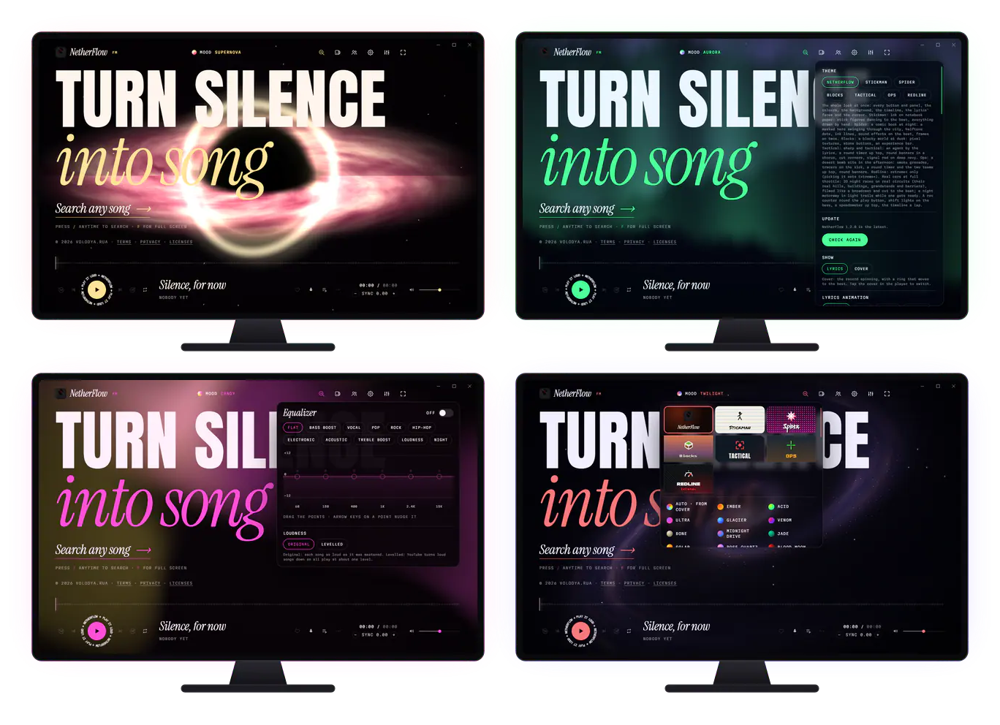
</p>

And this is it on a phone 👇 straight from the Android app:

<p align="center">
  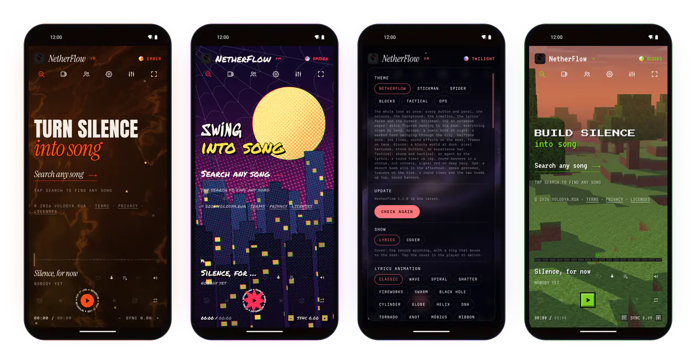
</p>

<a id="vs"></a>

## 🥊 NetherFlow vs Spotify, Apple Music & YouTube Music

Okay so how does it actually stack up against the big ones? I scored all four on the 10 things people really care about.
And no cap, NetherFlow doesn't win everything. I'm not gonna pretend it does.

<p align="center">
  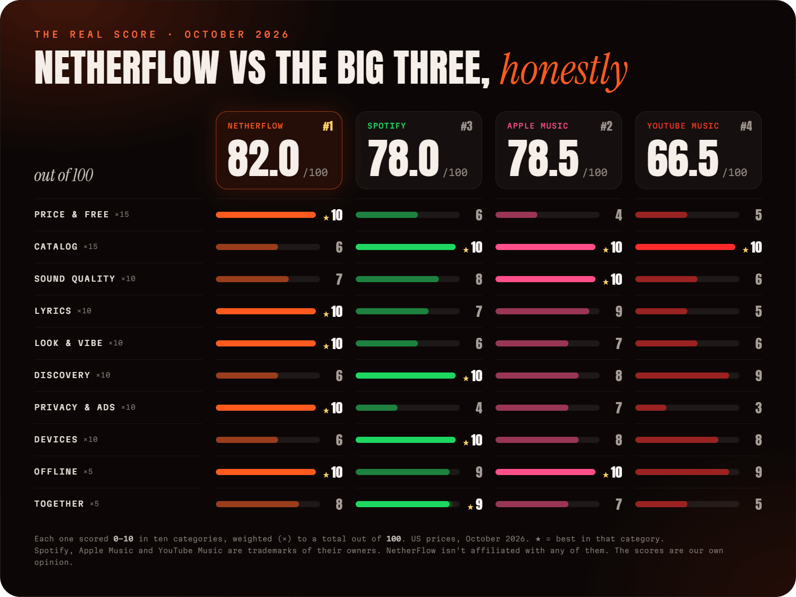
</p>

| | App | Score | Wins at |
|:-:|:--|:-:|:--|
| 🥇 | **NetherFlow** | **88.0** | price, lyrics, the look, privacy, offline, together |
| 🥈 | **Apple Music** | **78.5** | sound quality, offline, catalog |
| 🥉 | **Spotify** | **78.0** | discovery, devices, together, catalog |
| 4 | **YouTube Music** | **66.5** | catalog (covers, live versions, remixes) |

So NetherFlow comes out on top, **first (or tied for first) in six categories**. But it still doesn't win everything:
the big ones beat it on catalog, sound, discovery and devices. Here's the deep version 👇

<details open>
<summary><b>💸 Price & what's free</b></summary>

| | NetherFlow | Spotify | Apple Music | YouTube Music |
|:--|:--|:--|:--|:--|
| Price (US, a month) | ✅ **Free** | $12.99 | $11.99 | $11.99 |
| Free version | ✅ everything, unlocked | ⚠️ ads, limited on phones | ❌ just a free trial | ⚠️ ads, no background play on phones |
| Ads | ✅ none of its own | ⚠️ on the free version | ✅ none | ⚠️ on the free version |
| Account | ✅ not needed | needed | Apple ID | Google account |
| **Score** | **10** | 6 | 4 | 5 |
</details>

<details open>
<summary><b>🎵 Catalog</b></summary>

| | NetherFlow | Spotify | Apple Music | YouTube Music |
|:--|:--|:--|:--|:--|
| Songs | everything on YouTube, found through Apple's catalog | 100M+ | 100M+ | 100M+, plus YouTube's covers, live versions and remixes |
| Officially licensed | ❌ it plays the songs from YouTube | ✅ | ✅ | ✅ |
| Podcasts | ✅ every show in Apple's directory, saved for offline too | ✅ | ⚠️ in a separate app | ✅ |
| Audiobooks | ⚠️ free classics only (LibriVox, public domain in the US) | ✅ the bestsellers | ⚠️ in Apple Books | ❌ |
| Can break when YouTube changes stuff | ⚠️ yes, until an update fixes it | ✅ no | ✅ no | ✅ no |
| **Score** | 7 | **10** | **10** | **10** |
</details>

<details open>
<summary><b>🔊 Sound quality</b></summary>

| | NetherFlow | Spotify | Apple Music | YouTube Music |
|:--|:--|:--|:--|:--|
| Best quality | ~160 kbps Opus (320 kbps from Audius when the artist uploaded it there) | Lossless, up to 24-bit/44.1 kHz | Hi-Res Lossless up to 24-bit/192 kHz, plus Dolby Atmos | 256 kbps |
| Equalizer | ✅ built in, presets and a volume booster | ⚠️ on phones | ✅ presets | ⚠️ the phone's own (Android) |
| Headphone correction | ✅ 6,000+ headphones (AutoEQ) | ❌ | ⚠️ Apple's own headphones | ❌ |
| **Score** | 8 | 8 | **10** | 6 |
</details>

<details open>
<summary><b>🎤 Lyrics</b></summary>

| | NetherFlow | Spotify | Apple Music | YouTube Music |
|:--|:--|:--|:--|:--|
| Synced lyrics | ✅ word by word | ✅ line by line | ✅ word by word | ⚠️ line by line, on many songs |
| Lyrics animations | ✅ 19, plus 58 Extreme looks | ❌ | ⚠️ one style (a really nice one) | ❌ |
| Karaoke | ✅ Sing | ❌ | ✅ Apple Music Sing | ❌ |
| Lyrics fonts | ✅ 13 | ❌ | ❌ | ❌ |
| **Score** | **10** | 7 | 9 | 5 |
</details>

<details open>
<summary><b>🌈 Look & vibe</b></summary>

| | NetherFlow | Spotify | Apple Music | YouTube Music |
|:--|:--|:--|:--|:--|
| Moving backgrounds | ✅ 27, and they move with the beat | ⚠️ Canvas loops, when the artist made one | ⚠️ animated album covers | ⚠️ music videos |
| Themes that change the whole app | ✅ 6 | ❌ | ❌ | ❌ |
| Colour moods | ✅ 46 | ❌ | ❌ | ❌ |
| **Score** | **10** | 6 | 7 | 6 |
</details>

<details open>
<summary><b>🧭 Discovery</b></summary>

| | NetherFlow | Spotify | Apple Music | YouTube Music |
|:--|:--|:--|:--|:--|
| Recommendations | ✅ Your mix and Discover, from what you play, and Autoplay that learns from what you skip and like | ✅ Discover Weekly, AI DJ, daylist | ✅ stations, personal mixes | ✅ Supermix, strong recommendations |
| Curated playlists, charts, new releases | ✅ YouTube Music's charts, moods & genres, and new music from your artists | ✅ | ✅ | ✅ |
| Your year in music | ✅ your stats, any time | ✅ Wrapped | ✅ Replay | ✅ Recap |
| **Score** | 8 | **10** | 8 | 9 |
</details>

<details open>
<summary><b>🔒 Privacy & ads</b></summary>

| | NetherFlow | Spotify | Apple Music | YouTube Music |
|:--|:--|:--|:--|:--|
| Tracking | ✅ no analytics, nothing we can read reaches us | ⚠️ your listening shapes ads (free) and suggestions | ⚠️ your listening shapes suggestions | ⚠️ tied to your whole Google account |
| Open source | ✅ GPL v3 | ❌ | ❌ | ❌ |
| **Score** | **10** | 4 | 7 | 3 |
</details>

<details open>
<summary><b>📱 Devices</b></summary>

| | NetherFlow | Spotify | Apple Music | YouTube Music |
|:--|:--|:--|:--|:--|
| Phone | Android | Android, iPhone | iPhone, Android | Android, iPhone |
| Computer | Windows, Linux | Windows, Mac, Linux, web | Mac, Windows, web | ⚠️ web only |
| TV, speakers, car, watch | ⚠️ Android TV and Google TV, and lyrics on your car's display (Android) | ✅ basically everything | ✅ Apple's devices, and plenty more | ✅ lots |
| **Score** | 7 | **10** | 8 | 8 |
</details>

<details open>
<summary><b>📥 Offline & 🤝 together</b></summary>

| | NetherFlow | Spotify | Apple Music | YouTube Music |
|:--|:--|:--|:--|:--|
| Download songs | ✅ free, whole playlists at once (⚠️ YouTube's terms don't allow it) | ✅ Premium, 10,000 a device | ✅ up to 100,000 in your library | ✅ Premium |
| Listen together, live | ✅ up to 10 people, any phone or PC, no account, end-to-end encrypted | ✅ Jam | ✅ SharePlay (Apple devices) | ❌ not built in |
| Share a playlist | ✅ a QR code or a link (the songs show up even without the app) | ✅ a link, or a Spotify Code to scan | ✅ a link | ✅ a link |
| Playlists you edit together | ✅ anyone with the link, live, end-to-end encrypted, no account | ✅ | ✅ | ✅ |
| **Offline score** | **10** | 9 | **10** | 9 |
| **Together score** | **9** | **9** | 7 | 5 |
</details>

### 😤 Where NetherFlow loses (real talk)
- **It's not a licensed service.** It plays songs from YouTube, so it depends on YouTube. If YouTube
  changes something, stuff can break until an update fixes it
- **The sound tops out around 160 kbps.** On good headphones, Apple Music's and Spotify's lossless is clearly better
- **No iPhone and no Mac** (yet?). Windows, Linux, Android and Android TV
- **Audiobooks are free classics only** (LibriVox's), not the bestsellers Spotify and Apple have. And finding new music is
  good now, but Spotify's is still better
- **Artists earn less from your plays** than on the paid apps, since no YouTube ads play. If you love an artist,
  show them some love: buy the merch, go to the show, or stream them on a paid app too 🫶

### 🎯 So which one's for you?
- **NetherFlow**: you want your music to *look and feel* insane, lyrics that hit, and all of it free, with no account and no ads of its own
- **Spotify**: the best all-rounder. Finding new music, podcasts, and it works on literally everything
- **Apple Music**: the best sound, especially if you're on iPhone or Mac
- **YouTube Music**: covers, live versions and remixes nobody else has, or you already pay for YouTube Premium

And honestly? You can use NetherFlow **next to** any of them. Paste a playlist link from Spotify, Apple Music or YouTube
and it's in.

<sub>**How it's scored:** each app gets 0–10 in each category. Price and catalog count ×15 (they matter most to most
people); sound, lyrics, look, discovery, privacy and devices ×10; offline and listening together ×5. That adds up to a
total out of 100. US prices as of October 2026, from [Spotify](https://www.spotify.com/us/premium/),
[Apple](https://www.apple.com/apple-music/) and [YouTube](https://www.youtube.com/musicpremium). Spotify, Apple Music and
YouTube Music are trademarks of their respective owners. NetherFlow is not affiliated with, endorsed by or sponsored by
any of them. The scores are the author's own opinion.</sub>

<a id="hucla"></a>

## 🧠 HuCla

<p align="center"><b>Hu</b>man × <b>Cla</b>ude</p>

Okay so real talk. NetherFlow is a **HuCla** build.

The idea, the vision, how it should look and feel, that's me. I came up with what NetherFlow should be, picked every
theme, every background and every vibe, tested every single build on my PC and my phone, and kept saying "nah, make it
crazier" until it was right.

The code? That's mostly **[Claude](https://www.anthropic.com/claude)**, Anthropic's AI. Like most of it: the player, the
lyric engine, every shader behind the backgrounds, the 3D races, the Android app, even most of this README. I bring the
ideas, Claude builds them, and we go back and forth until it's right.

And see, it's all out in the open: every commit Claude worked on says so with a `Co-Authored-By: Claude` line.

## 🛠️ How it works

NetherFlow doesn't host any music, videos or lyrics. It finds them on other services and plays them straight from there:

| What | From |
|:--|:--|
| Song search, artwork | Apple's iTunes Search API, YouTube Music |
| Playback | FlowStream, NetherFlow's own player: the audio and music videos from YouTube's servers, as YouTube serves them to its own apps (yt-dlp as a backup); [Audius](https://audius.co) when the artist's own upload is there (320 kbps) |
| Lyrics | [LRCLIB](https://lrclib.net), NetEase Cloud Music, Kugou, YouTube Music (lyrics by LyricFind) |
| Explore | YouTube Music's charts, new releases, moods and genres; your mixes from its radio for the songs you play most |
| Podcasts | Apple's podcast directory and charts; the episodes from each show's own feed and host |
| Audiobooks | [LibriVox](https://librivox.org)'s recordings (public domain in the US), from the [Internet Archive](https://archive.org) |
| Headphone correction | [AutoEQ](https://github.com/jaakkopasanen/AutoEq)'s published results (MIT), fetched when you pick your headphones |
| Playlists you make together | NetherFlow's own relay on Cloudflare (public MQTT relays as a backup), end-to-end encrypted with a key from the playlist link |
| Saving for offline | FlowStream saves the audio from YouTube, as YouTube serves it (its best, Opus), with [yt-dlp](https://github.com/yt-dlp/yt-dlp) as a backup; podcast episodes and audiobook chapters come as their host serves them |
| Redline's circuits | [OpenStreetMap](https://www.openstreetmap.org/copyright) map data and NASA's SRTM heights, made into `race/` ahead of time |

The desktop app (Windows and Linux) is [Electron](https://www.electronjs.org), the Android app (phones and TVs) is
[Capacitor](https://capacitorjs.com) with yt-dlp running in Python through [Chaquopy](https://chaquo.com/chaquopy/), and
both run the same page, `index.html`. FlowStream (`flowstream.js`) is NetherFlow's own code; it uses the same
requests to YouTube that yt-dlp does.
Redline's races are drawn with [three.js](https://threejs.org).

<details>
<summary><b>🔧 Build it yourself</b></summary>

You need [Node.js](https://nodejs.org) 20 or newer.

**Windows**

```bash
npm ci
npm start      # run it
npm run dist   # build the installer and the portable app into dist/ (fetches yt-dlp.exe first and checks its SHA-256)
npm test       # a quick self-test: plays a song and checks the lyrics sync
```

NetherFlow Lite: `npx electron-builder --win nsis portable --publish never --config tools/lite-build.js` (into `dist/lite`).

Discord status uses NetherFlow's own application at Discord (its id, public, is `DISCORD_ID` in `main.js`; a fork can
use its own there or with the `NETHERFLOW_DISCORD_ID` environment variable). Its logo, for Discord, is in `docs/logo/`.

**Linux** (on Linux; GitHub's Ubuntu builds the releases' with `.github/workflows/linux.yml`)

```bash
npm ci
npm run dist:linux   # an AppImage and a .deb into dist/ (fetches yt-dlp_linux first and checks its SHA-256)
```

**Android**: you also need JDK 21 and the Android SDK (API level 36).

```bash
npm ci
npm run android:sync              # copies the page into the Android project
cd android && ./gradlew assembleRelease
```

The APK lands in `android/app/build/outputs/apk/release/`. Release builds are signed only if a signing key is set up
outside the repository, in `~/.netherflow-signing/` (or the folder named by `NETHERFLOW_SIGNING`): a
`keystore.properties` with `storeFile`, `storePassword`, `keyAlias` and `keyPassword`, next to the key file. Otherwise
they come out unsigned (as F-Droid wants them). Add `-PnfEmulator` to include x86 and x86_64 for an emulator. On Windows,
`android-build.cmd` does all of this.
</details>

## 🔒 Privacy

NetherFlow has no accounts and no analytics, and nothing it sends reaches its developer in a form anyone there can read. Your settings, library and saved songs
stay on your device. When you use it, it talks directly to the services above (GitHub too: to look for a newer
NetherFlow; podcast hosts and the Internet Archive for podcasts and audiobooks), which see your IP address. A
playlist you share lives only inside its link (the page it opens, on GitHub Pages, never gets the songs part); one you
edit together is kept on NetherFlow's own relay (on Cloudflare; for now public relays too, as a backup), encrypted with a key from its link, so anyone with the link can read and change it. The full [Privacy Policy](https://volodya-rua.github.io/NetherFlow/legal.html#privacy) is in the app and on the website.

## ⚖️ Legal

- NetherFlow is an independent project. It is **not affiliated with, endorsed by or sponsored by** YouTube, Google,
  Apple, Audius, LRCLIB, NetEase, Kugou, LyricFind, the Internet Archive, LibriVox, AutoEQ, any podcast or its publisher,
  or any artist, label or publisher. All names, trademarks, music,
  videos, lyrics and artwork belong to their respective owners.
- NetherFlow **hosts no content**. Everything it plays comes straight from the services above to your device.
- **Saving for offline downloads from YouTube, which YouTube's Terms of Service don't allow**, and copyright law where
  you live may not allow it either. Whether to use it is your choice and your responsibility: only save what you're
  allowed to keep, for your own personal listening.
- NetherFlow plays songs straight from YouTube, so no ads play; it doesn't block or skip anything.
- The [Terms of Use](https://volodya-rua.github.io/NetherFlow/legal.html#terms) apply to using the app. If you hold rights in something and have a concern,
  contact the developer (below): every notice is reviewed in good faith.
- Redline's 3D races are built from [© OpenStreetMap contributors](https://www.openstreetmap.org/copyright)' map data:
  the circuits and what's round them (ODbL 1.0, as are `race/tracks.json` and `race/maps/`, made from it by
  `tools/race-tracks.js`), with heights from NASA's SRTM (public domain) through OpenTopoData. The cars are CC BY 4.0
  models from Sketchfab, credited in `race/cars.json` and the app (they come inside it); the cars' makers don't endorse
  or sponsor NetherFlow. The race images here show map data © OpenStreetMap contributors.
- The software is provided **as is**, without warranty of any kind (see the license).

<a id="license"></a>

## 📄 License

NetherFlow is © 2026 Volodya.rua and released under the [GNU General Public License v3](LICENSE), with a few additional
terms in [NOTICE](NOTICE):

- **Use it, change it, share it.** Anyone can, as long as their version stays open source under the same license
- **Keep the credit.** Every copy and every changed version shows "NetherFlow by Volodya.rua", with a link here, in
  its credits
- **A name and logo of its own.** A changed version needs its own name and icon. The NetherFlow name and logo aren't
  licensed to anyone

NetherFlow 1.3.1 and earlier came out under the MIT License, and copies of those keep it.

Third-party code in this repository keeps its own license: the 27 typefaces in `fonts/` (SIL Open Font License 1.1; Permanent Marker, Special
Elite and Yellowtail under the Apache License 2.0), Microsoft's Fluent Emoji in `emoji/` (MIT), and three.js in
`race/three/` (MIT). The three songs on the website in `docs/media/music/` are by HoliznaCC0, in the public domain
(CC0 1.0). The builds also include Electron (with Chromium, Node.js and FFmpeg), Capacitor and electron-updater, each under its own license. All
license texts are in [`licenses/`](licenses); the full list of components is in the app under About › Licenses.

<a id="hit-me-up"></a>

## 📬 Hit me up

Wanna talk, found a bug, got an idea for a theme? Hit me up.

<p align="center">
  <a href="https://www.instagram.com/volodya.rua/"></a>
  <a href="mailto:volodya.rua@gmail.com"></a>
  <br><br>
  <sub>made by <b>Volodya.rua</b> · a <b>HuCla</b> build</sub>
</p>
