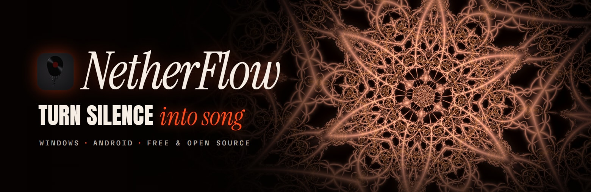
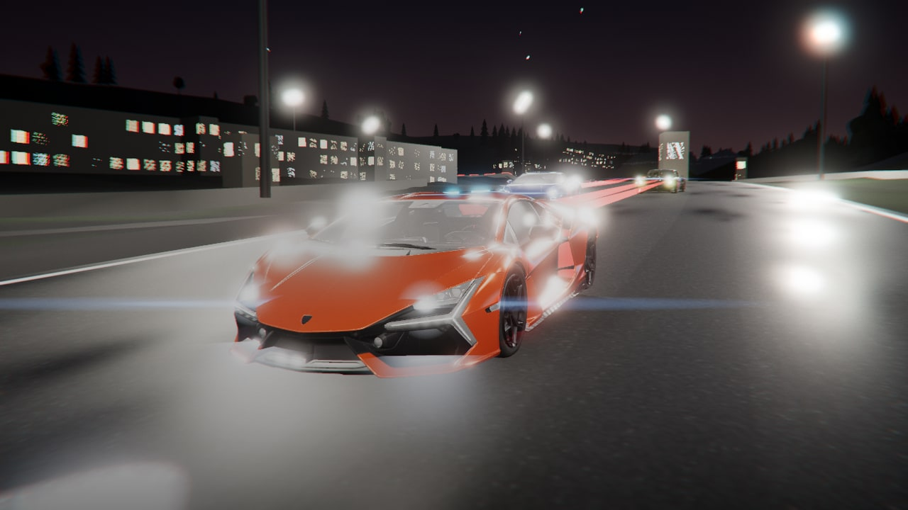
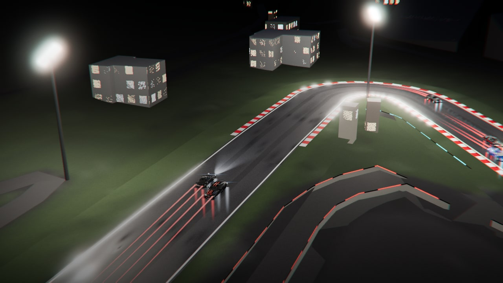
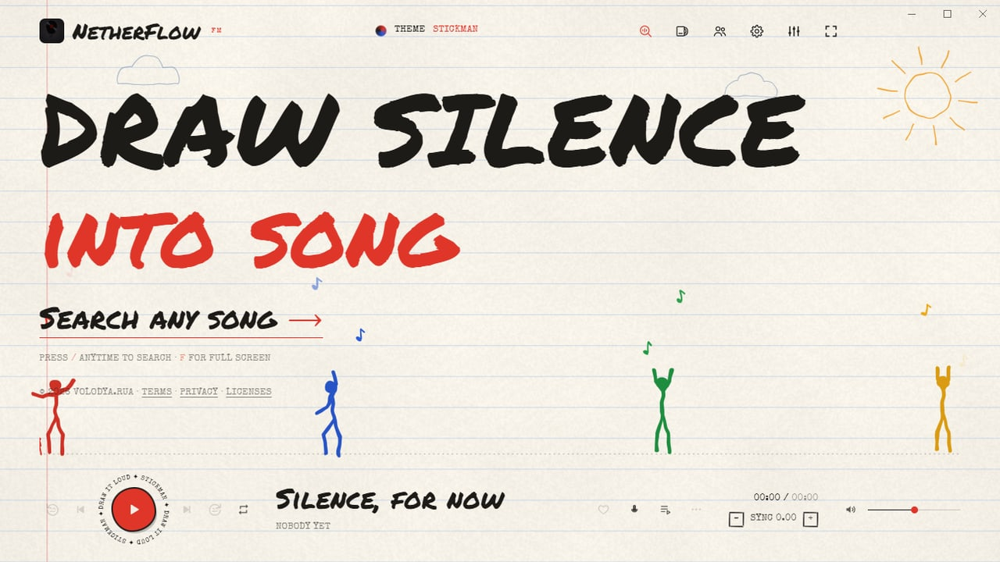
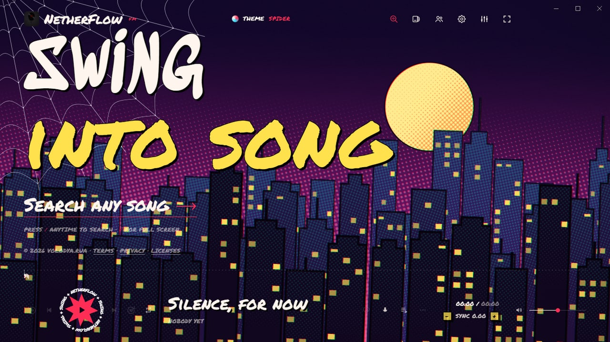
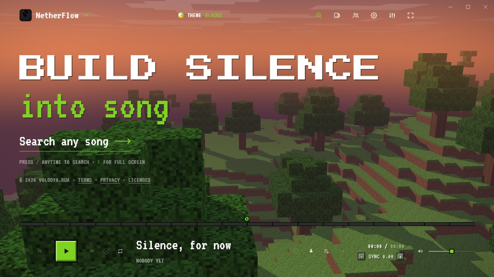
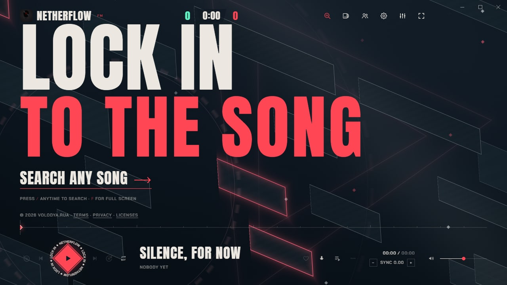
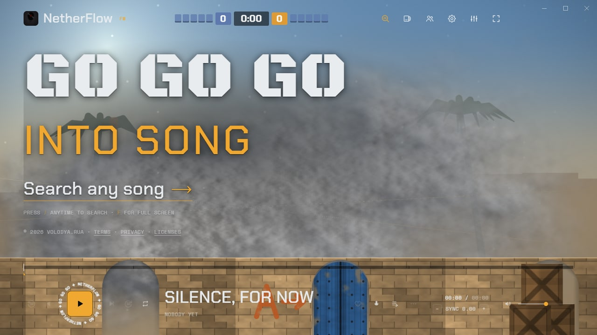
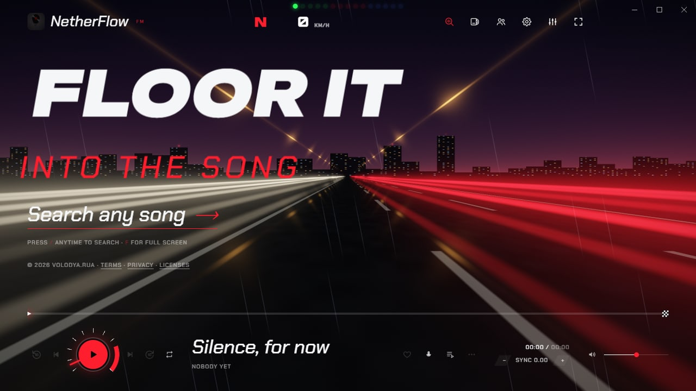
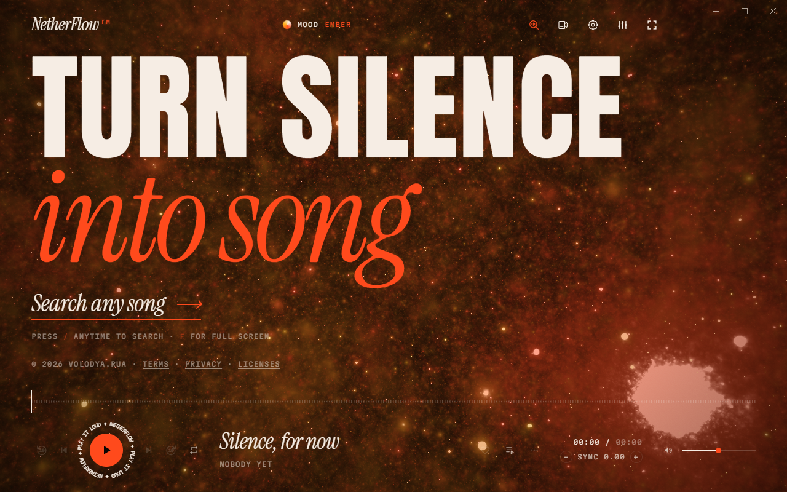

<p align="center">
  
</p>

<p align="center">
  <a href="https://github.com/volodya-rua/NetherFlow/releases/latest"></a>
  <a href="https://github.com/volodya-rua/NetherFlow/releases"></a>
  
  <a href="LICENSE"></a>
  <br>
  <a href="#made-with-claude"></a>
  <a href="https://www.instagram.com/volodya.rua/"></a>
</p>

<p align="center">
  <b>Turn silence into song.</b> A free, open-source music player for Windows and Android: search any song, play it in
  full, and follow its lyrics word by word over moving, music-reactive backgrounds — or real cars racing round real circuits.
</p>

<p align="center">
  <a href="#download"><b>Download</b></a> ·
  <a href="#whats-new-in-12">What's new</a> ·
  <a href="#themes">Themes</a> ·
  <a href="#features">Features</a> ·
  <a href="#made-with-claude">Made with Claude</a> ·
  <a href="#build-from-source">Build</a> ·
  <a href="#contact">Contact</a>
</p>

## Download

From the [latest release](https://github.com/volodya-rua/NetherFlow/releases/latest):

| | Installer | Portable |
|---|---|---|
| **Windows** | `NetherFlow-Setup-<version>.exe`: installs for you alone (no admin needed), with Start-menu and desktop shortcuts, an uninstaller in Windows' Settings, and updates in the app | `NetherFlow-<version>-Windows.exe`: runs as it is, nothing to install |
| **Windows, Lite** | `NetherFlow-Lite-Setup-<version>.exe` | `NetherFlow-Lite-<version>-Windows.exe` |
| **Android** (7.0 or newer) | `NetherFlow-<version>.apk` | |

**Lite** is the same app without Extreme+ (no Redline theme, its 3D races or their cars), about 18 MB smaller. It updates to Lite.

## What's new in 1.2

<table>
  <tr>
    <td width="50%"></td>
    <td width="50%"></td>
  </tr>
</table>

- **Redline's 3D races** (Windows, Extreme+): a night race behind the lyrics, on **eight real circuits** — Spa-Francorchamps,
  Monza, Suzuka, Interlagos, the Nürburgring, Zandvoort, Imola and the Red Bull Ring — built from OpenStreetMap with their
  real layouts, hills, buildings, grandstands and crowds, barriers, gravel and forests. **Five real cars** (a Porsche 911
  Turbo, a Lamborghini Revuelto and Temerario, a BMW M4 CSL and the Hoonicorn) drive themselves: braking for every corner by
  their own grip, slipstreaming, overtaking side by side, the Hoonicorn drifting in its own smoke. Filmed like a broadcast
  and cut on the beat — chase, onboard, trackside, helicopter — with the start lights counting down a build-up and the field
  blasting under the gantry in slow motion as the chorus lands
- **Smooth music videos**: behind Extreme lyrics, the song's official video now plays straight through, in time with the
  song when the two are the same length — no jump cuts, flashes or shakes
- **Never frozen**: on Windows the lyrics, backgrounds and races keep moving whenever NetherFlow is on screen, even with
  another window in front
- **NetherFlow Lite** for Windows, and **Settings › 3D race** with its state and a *Load now* button

## Themes

Six themes change the whole look at once — every button and panel, the colours, the faces, the cursor, the timeline, a
backdrop of their own and their own Extreme lyrics look (the top of the mood menu, or Settings; five on Android).

<table>
  <tr>
    <td width="33%"><br><b>Stickman</b><br><sub>Notebook paper and ink, stick figures dancing to the beat on the timeline</sub></td>
    <td width="33%"><br><b>Spider</b><br><sub>A comic book at night: a masked hero swinging through the city on twos, halftone dots, POW and WHAM on the beat</sub></td>
    <td width="33%"><br><b>Blocks</b><br><sub>A blocky world at dusk to fly over, stone buttons, an experience bar, letters dropping in as blocks</sub></td>
  </tr>
  <tr>
    <td width="33%"><br><b>Tactical</b><br><sub>An agent from VALORANT by the lyrics, a round timer up top, ACE and CLUTCH banners in a chorus, signal red on navy</sub></td>
    <td width="33%"><br><b>Ops</b><br><sub>A desert bomb site in the afternoon, smoke and tracers on the kick, "Bomb has been planted", the lyrics as a kill feed</sub></td>
    <td width="33%"><br><b>Redline</b> <sub>(Windows, Extreme+)</sub><br><sub>Real cars racing on real circuits in 3D; a rev counter round the play button, shift lights on the bass</sub></td>
  </tr>
</table>

## Features

### 🎧 Listen

- **Search** songs, artists and albums, and play them in full: typos fixed, suggestions as you type, and YouTube Music's
  catalog alongside Apple's
- **Autoplay**: when the list runs out, songs like the one playing carry on, as on YouTube Music: from its radio for the
  song, ranked to the session (the same language and era, songs that fit the last few, more of the artists you play
  through or like and less of those you skip, never one you just heard); the next few picks show in the queue
- **Smooth mix**: songs blend into each other like a DJ mix, starting on a beat, quiet endings skipped
- **Equalizer** with presets, a volume booster, and each song at its **original loudness** (YouTube turns loud songs
  down; NetherFlow gives that back)
- **Save for offline**: one song, or a whole playlist with *Download all* (three at a time)
- **Import playlists** of any length from Spotify, Apple Music or YouTube: paste the link (Library › Import playlist, or
  in the search)
- **Library**: liked songs, playlists, queue and history, kept on your device
- **Your stats** (Library): minutes, plays, a streak, top songs, artists and genres, when you listen — this month, this
  year, all time — and a card to share

### 🎤 Lyrics

- **Synced lyrics**, word by word where available, lined up to YouTube Music's own timing for the very recording that
  plays, with **19 lyric animations**: Classic, Wave, Spiral, Shatter, Fireworks, Swarm, Black Hole, Cylinder, Globe,
  Helix, DNA, Tornado, Knot, Möbius, Ribbon, Orbit, Atom, Tunnel and Cube
- **Extreme lyrics** (Windows, at Extreme quality): the lyrics cut like a music video or an Instagram lyric edit, every
  word coming in as it's sung in **58 looks** — chat bubbles, shattering glass, holographic foil, a slot machine, liquid
  filling the letters, label tape, grunge block letters, a typewriter, decoding, extruded 3D, Y2K chrome, neon signs, a
  turning cube, a split-flap board, graffiti, a ransom-note collage, karaoke, a strobe and more — with film scratches,
  glitches, glow and light leaks on the beat. Mixed (a new look every few words) or one look of your choice; all 1,595 of
  Microsoft's 3D Fluent emoji popping up by the words they fit ("fire", "moon", "dil"…); and when the song has an
  official music video, it plays behind the words, smoothly, straight through, in one colour grade for the song
- **Sing**: karaoke — the voice turned down (a slider for how much stays), the lyrics big
- **13 lyric font pairs**: Poster, Vogue, Neon, Arcade, Vinyl, Glitch, Graffiti, Cyber, Wide, Stencil, Bubble, Melt and
  Gothic
- **Story clips**: a short video of a song with its lyrics, sized for Instagram stories

### 🌌 Look

- **27 animated backgrounds** — fractals, galaxies, a plasma globe, hyperbolic tilings and more — that take their
  colours from the album cover; or a still **Gradient** in the same colours, the lightest for a slower phone
- **Quality from Low to Ultra**, and **Extreme** and **Extreme+** on Windows; on a slower device the background steps
  down by itself
- A **beat ring** and screen edges that move with the music, **12 timeline styles** and **46 moods**
- **6 themes** (above) that change everything at once

<table>
  <tr>
    <td width="50%"></td>
    <td width="50%"></td>
  </tr>
</table>

### 🤝 Together

- **Listen together**: up to 10 people hear the same song at the same moment, each on their own device; anyone can add
  songs, skip and react (end-to-end encrypted, through a public relay: no account, no server of ours)
- **Phone ↔ PC sync**: liked songs, playlists, history and stats swapped over your own Wi-Fi with a 6-number code — no
  account
- **Discord status** (Windows): "Listening to" the song on your Discord profile, with its cover and progress

### 🪟 On Windows and 📱 on Android

- **Windows**: a **now-playing island** at the top middle of the screen, over every app — the song and its beat; click
  it for the cover, timeline, volume and controls
- **Android**: a home-screen widget, lyrics on the lock screen (and in the notification and on a car's display), liked
  songs saved for offline by themselves on Wi-Fi
- **Updates in the app** (Settings › Update): the Windows installer updates itself, downloading only the parts that
  changed; NetherFlow's own Android app (from GitHub) downloads only the changed files of a release, signed by its
  developer and checked before use, or the new app when a release changes more than the page (an app store's build is
  updated by the store). The portable Windows app can't update itself
- **Light**: minimized or in the background, nothing is drawn at all
- **No account, no ads of its own, no analytics, no tracking**

<p align="center">
  
  
</p>

## Made with Claude

NetherFlow is **mostly written by [Claude](https://www.anthropic.com/claude)**, Anthropic's AI, working in Claude Code.
Volodya.rua came up with NetherFlow, decided what it should do and how it should look, tested every build on real
devices and published it; Claude wrote most of the code — the player and its lyric engine, the shaders behind every
background, the 3D races, the Android app — and most of this documentation. Every commit Claude worked on says so, with a
`Co-Authored-By: Claude` line.

## How it works

NetherFlow doesn't host any music, videos or lyrics. It finds them on other services and shows them to you directly
from those services:

| What | From |
|---|---|
| Song search, artwork | Apple's iTunes Search API, YouTube Music |
| Playback | YouTube's embedded player; [Audius](https://audius.co) when the artist's own upload is there (320 kbps) |
| Lyrics | [LRCLIB](https://lrclib.net), NetEase Cloud Music, Kugou, YouTube Music (lyrics by LyricFind) |
| Saving for offline | [yt-dlp](https://github.com/yt-dlp/yt-dlp) downloads the audio from YouTube, as YouTube serves it |
| Redline's circuits | [OpenStreetMap](https://www.openstreetmap.org/copyright) map data and NASA's SRTM heights, made into `race/` ahead of time |

The desktop app is [Electron](https://www.electronjs.org); the Android app is [Capacitor](https://capacitorjs.com),
with yt-dlp running in Python through [Chaquopy](https://chaquo.com/chaquopy/). Both run the same page, `index.html`.
Redline's races are drawn with [three.js](https://threejs.org).

## Build from source

You need [Node.js](https://nodejs.org) 20 or newer.

### Windows

```bash
npm ci
npm start      # run it
npm run dist   # build the installer and the portable app into dist/ (fetches yt-dlp.exe first and checks its SHA-256)
npm test       # a quick self-test: plays a song and checks the lyrics sync
```

NetherFlow Lite: `npx electron-builder --win nsis portable --publish never --config tools/lite-build.js` (into `dist/lite`).

Discord status uses NetherFlow's own application at Discord (its id, public, is `DISCORD_ID` in `main.js`; a fork can
use its own there or with the `NETHERFLOW_DISCORD_ID` environment variable). Its logo, for Discord, is in `docs/logo/`.

### Android

You also need JDK 21 and the Android SDK (API level 36).

```bash
npm ci
npm run android:sync              # copies the page into the Android project
cd android && ./gradlew assembleRelease
```

The APK lands in `android/app/build/outputs/apk/release/`. Release builds are signed only if a signing key is set up
outside the repository, in `~/.netherflow-signing/` (or the folder named by `NETHERFLOW_SIGNING`): a
`keystore.properties` with `storeFile`, `storePassword`, `keyAlias` and `keyPassword`, next to the key file. Otherwise
they come out unsigned (as F-Droid wants them). Add `-PnfEmulator` to include x86_64 for an emulator. On Windows,
`android-build.cmd` does all of this.

## Privacy

NetherFlow has no accounts and no analytics, and sends nothing to its developer. Your settings, library and saved songs
stay on your device. When you use it, it talks directly to the services above (GitHub too: to look for a newer
NetherFlow, and to update yt-dlp, on Android only if you turn on "Update the downloader"; and valorant-api.com, only with
the Tactical theme), which see your IP address. The full [Privacy Policy](legal.html#privacy) is in the app.

## Legal

- NetherFlow is an independent project. It is **not affiliated with, endorsed by or sponsored by** YouTube, Google,
  Apple, Audius, LRCLIB, NetEase, Kugou, LyricFind or any artist, label or publisher. All names, trademarks, music,
  videos, lyrics and artwork belong to their respective owners.
- NetherFlow **hosts no content**. Everything it plays comes straight from the services above to your device.
- **Saving for offline downloads from YouTube, which YouTube's Terms of Service don't allow**, and copyright law where
  you live may not allow it either. Whether to use it is your choice and your responsibility: only save what you're
  allowed to keep, for your own personal listening.
- NetherFlow also skips and blocks ads inside YouTube's player, which YouTube's terms may not allow.
- The [Terms of Use](legal.html#terms) apply to using the app. If you hold rights in something and have a concern,
  contact the developer (below): every notice is reviewed in good faith.
- The Tactical theme shows VALORANT's agents: NetherFlow was created under Riot Games' "Legal Jibber Jabber" policy using
  assets owned by Riot Games. Riot Games does not endorse or sponsor this project. The art isn't in this repository or
  under its license (the screenshots here leave it out): the app fetches it from valorant-api.com while that theme is on.
- Redline's 3D races are built from [© OpenStreetMap contributors](https://www.openstreetmap.org/copyright)' map data:
  the circuits and what's round them (ODbL 1.0, as are `race/tracks.json` and `race/maps/`, made from it by
  `tools/race-tracks.js`), with heights from NASA's SRTM (public domain) through OpenTopoData. The cars are CC BY 4.0
  models from Sketchfab, credited in `race/cars.json` and the app (they come inside it); the cars' makers don't endorse
  or sponsor NetherFlow. The race screenshots here show map data © OpenStreetMap contributors.
- The software is provided **as is**, without warranty of any kind (see the license).

## License

NetherFlow is © 2026 Volodya.rua and released under the [MIT License](LICENSE). If you publish a changed version,
please give it a different name and icon so nobody mistakes it for the original.

Third-party code in this repository keeps its own license: yt-dlp (The Unlicense) and certifi (MPL 2.0) in
`android/app/src/main/python/`, the 27 typefaces in `fonts/` (SIL Open Font License 1.1; Permanent Marker, Special
Elite and Yellowtail under the Apache License 2.0), Microsoft's Fluent Emoji in `emoji/` (MIT), and three.js in
`race/three/` (MIT). The builds also include Electron (with Chromium, Node.js and FFmpeg), Capacitor, Chaquopy (with
Python), electron-updater and, on Windows, `yt-dlp.exe`, each under its own license. All license texts are in
[`licenses/`](licenses); the full list of components is in the app under About › Licenses.

## Contact

<p align="center">
  Made by <b>Volodya.rua</b>, with Claude<br>
  <a href="https://www.instagram.com/volodya.rua/"></a>
  <a href="mailto:volodya.rua@gmail.com"></a>
</p>
