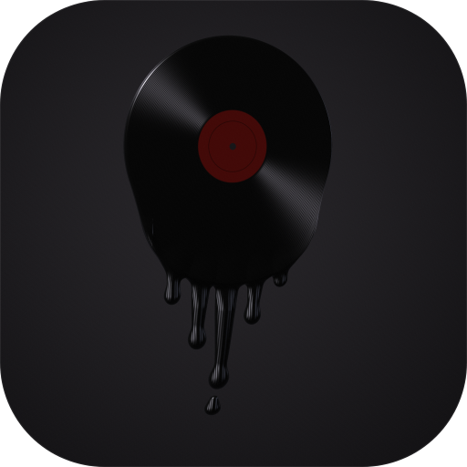
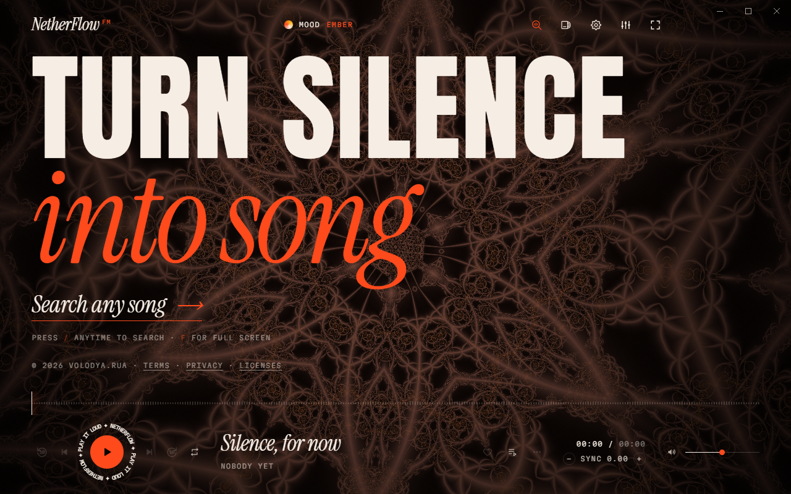
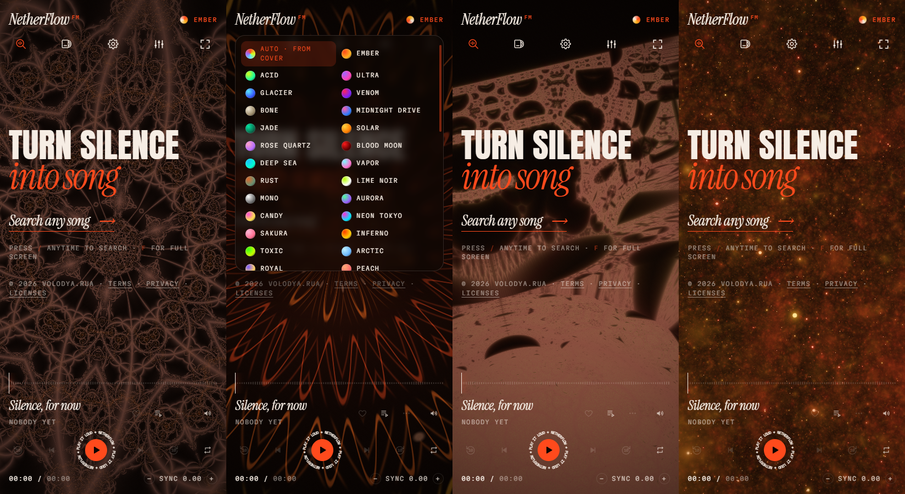
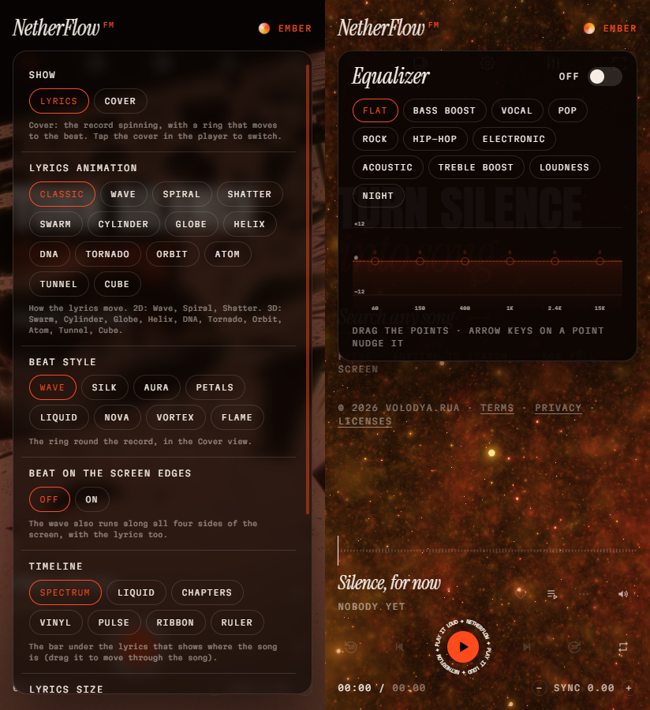

# NetherFlow

**Turn silence into song.** A free, open-source music player for Windows and Android: search any song, play it in
full, and follow its lyrics word by word over moving, music-reactive backgrounds.





## Download

From the [latest release](https://github.com/volodya-rua/NetherFlow/releases/latest):

- **Windows**: `NetherFlow-Setup-<version>.exe`, the installer. It installs for you alone (no admin needed), with Start-menu
  and desktop shortcuts and an uninstaller in Windows' Settings. Or `NetherFlow-<version>-Windows.exe`, portable: it runs as it is,
  with nothing to install.
- **Android**: `NetherFlow-<version>.apk` (Android 7.0 or newer).

## Features

- **Search** songs, artists and albums, and play them in full: typos fixed, suggestions as you type, and YouTube Music's
  catalog alongside Apple's
- **Synced lyrics**, word by word where available, with 19 lyric animations: Classic, Wave, Spiral, Shatter, Fireworks,
  Swarm, Black Hole, Cylinder, Globe, Helix, DNA, Tornado, Knot, Möbius, Ribbon, Orbit, Atom, Tunnel and Cube; lined up
  to YouTube Music's own timing for the very recording that plays
- **27 animated backgrounds** (fractals, galaxies, a plasma globe, hyperbolic tilings and more) that take their colors from the album
  cover, up to an Ultra quality setting (and Extreme on Windows); or a still **Gradient** in the same colors, the
  lightest for a slower phone
- **Extreme lyrics** (Windows, at Extreme quality): the lyrics cut like a music video or an Instagram lyric edit, every
  word coming in as it's sung in 52 looks (chat bubbles, shattering glass, holographic foil, a slot machine, liquid filling the letters, label tape, grunge block letters, typewriter, decoding, extruded 3D, Y2K chrome, neon
  signs, a turning cube, a split-flap board, graffiti, a ransom-note collage, karaoke, a strobe and more), with film scratches, glitches, glow and light leaks on the beat.
  Mixed (a new look every few words) or one look of your choice; and all 1,595 of Microsoft's 3D Fluent emoji popping up by
  the words they fit ("fire", "moon", "dil"…) and the emoji in the lyrics themselves, which you can turn off. And when the song has an official music video, it plays behind the words, cut to the
  music the way editors cut one for TikTok and Reels: a new shot on the beat in a chorus, zoom punches, flashes, shakes and colour
  fringes as shots land; a slow push in and dissolves in a verse; a grade for each part of the song (teal and orange, hard black and white, warm film, duotone in the cover's colours)
- A **beat ring** and screen edges that move with the music, 12 timeline styles and 46 moods to choose from
- **13 lyric font pairs** (Poster, Vogue, Neon, Arcade, Vinyl, Glitch, Graffiti, Cyber, Wide, Stencil, Bubble, Melt, Gothic)
- On Windows, a **now-playing island** at the top middle of the screen, over every app: the song and its beat; click it for the cover, timeline, volume and controls
- **Import playlists** from Spotify, Apple Music or YouTube: paste the link (Library › Import playlist, or in the search)
- **Your stats** (Library): minutes, plays, a streak, top songs, artists and genres, when you listen — this month, this year,
  all time — and a card to share
- **Sing**: karaoke — the voice turned down (a slider for how much stays), the lyrics big
- **Listen together**: up to 10 people hear the same song at the same moment, each on their own device; anyone can add
  songs, skip and react (end-to-end encrypted, through a public relay: no account, no server of ours)
- **Phone ↔ PC sync**: liked songs, playlists, history and stats swapped over your own Wi-Fi with a 6-number code — no account
- **Discord status** (Windows): "Listening to" the song on your Discord profile, with its cover and progress
- **Android**: a home-screen widget, lyrics on the lock screen (and in the notification and on a car's display), liked
  songs saved for offline by themselves on Wi-Fi
- **Autoplay**: when the list runs out, songs like the one playing carry on, as on YouTube Music: from its radio for the
  song, ranked to the session (the same language and era, songs that fit the last few, more of the artists you play through
  or like and less of those you skip, never one you just heard); the next few picks show in the queue
- **Smooth mix**: songs blend into each other like a DJ mix, starting on a beat, quiet endings skipped
- **Equalizer** with presets, a volume booster, and each song at its **original loudness** (YouTube turns loud songs
  down; NetherFlow gives that back)
- **Library**: liked songs, playlists, queue and history, kept on your device
- **Save for offline**: one song, or a whole playlist with *Download all* (three at a time)
- **Story clips**: a short video of a song with its lyrics, sized for Instagram stories
- **Light when it's not in front**: behind another app only the lyrics keep moving; minimized or in the background,
  nothing is drawn at all. On a slower device the background steps down in quality by itself
- No account, no ads of its own, no analytics, no tracking



## How it works

NetherFlow doesn't host any music, videos or lyrics. It finds them on other services and shows them to you directly
from those services:

| What | From |
|---|---|
| Song search, artwork | Apple's iTunes Search API, YouTube Music |
| Playback | YouTube's embedded player; [Audius](https://audius.co) when the artist's own upload is there (320 kbps) |
| Lyrics | [LRCLIB](https://lrclib.net), NetEase Cloud Music, Kugou, YouTube Music (lyrics by LyricFind) |
| Saving for offline | [yt-dlp](https://github.com/yt-dlp/yt-dlp) downloads the audio from YouTube, as YouTube serves it |

The desktop app is [Electron](https://www.electronjs.org); the Android app is [Capacitor](https://capacitorjs.com),
with yt-dlp running in Python through [Chaquopy](https://chaquo.com/chaquopy/). Both run the same page, `index.html`.

## Build from source

You need [Node.js](https://nodejs.org) 20 or newer.

### Windows

```bash
npm ci
npm start      # run it
npm run dist   # build the installer and the portable app into dist/ (fetches yt-dlp.exe first and checks its SHA-256)
npm test       # a quick self-test: plays a song and checks the lyrics sync
```

Discord status uses NetherFlow's own application at Discord (its id, public, is `DISCORD_ID` in `main.js`; a fork can
use its own there or with the `NETHERFLOW_DISCORD_ID` environment variable). Its logo, for Discord, is in `docs/logo/`.

### Android

You also need JDK 21 and the Android SDK (API level 36).

```bash
npm ci
npm run android:sync              # copies the page into the Android project
cd android && ./gradlew assembleRelease
```

The APK lands in `android/app/build/outputs/apk/release/`. Release builds are signed only if a signing key is set up
outside the repository, in `~/.netherflow-signing/` (or the folder named by `NETHERFLOW_SIGNING`): a
`keystore.properties` with `storeFile`, `storePassword`, `keyAlias` and `keyPassword`, next to the key file. Otherwise
they come out unsigned (as F-Droid wants them). Add `-PnfEmulator` to include x86_64 for an emulator. On Windows,
`android-build.cmd` does all of this.

## Privacy

NetherFlow has no accounts and no analytics, and sends nothing to its developer. Your settings, library and saved songs
stay on your device. When you use it, it talks directly to the services above (and GitHub, to update yt-dlp), which see
your IP address. The full [Privacy Policy](legal.html#privacy) is in the app.

## Legal

- NetherFlow is an independent project. It is **not affiliated with, endorsed by or sponsored by** YouTube, Google,
  Apple, Audius, LRCLIB, NetEase, Kugou, LyricFind or any artist, label or publisher. All names, trademarks, music, videos, lyrics and
  artwork belong to their respective owners.
- NetherFlow **hosts no content**. Everything it plays comes straight from the services above to your device.
- **Saving for offline downloads from YouTube, which YouTube's Terms of Service don't allow**, and copyright law where
  you live may not allow it either. Whether to use it is your choice and your responsibility: only save what you're
  allowed to keep, for your own personal listening.
- NetherFlow also skips and blocks ads inside YouTube's player, which YouTube's terms may not allow.
- The [Terms of Use](legal.html#terms) apply to using the app. If you hold rights in something and have a concern,
  contact the developer (below): every notice is reviewed in good faith.
- The software is provided **as is**, without warranty of any kind (see the license).

## License

NetherFlow is © 2026 Volodya.rua and released under the [MIT License](LICENSE). If you publish a changed version,
please give it a different name and icon so nobody mistakes it for the original.

Third-party code in this repository keeps its own license: yt-dlp (The Unlicense) and certifi (MPL 2.0) in
`android/app/src/main/python/`, and the 27 typefaces in `fonts/` (SIL Open Font License 1.1; Permanent Marker, Special
Elite and Yellowtail under the Apache License 2.0), and Microsoft's Fluent Emoji in `emoji/` (MIT). The builds also include Electron (with Chromium, Node.js and FFmpeg),
Capacitor, Chaquopy (with Python) and, on Windows, `yt-dlp.exe`, each under its own license. All license texts are in
[`licenses/`](licenses); the full list of components is in the app under About › Licenses.

## Contact

Volodya.rua · [volodya.rua@gmail.com](mailto:volodya.rua@gmail.com) · Instagram
[@volodya.rua](https://www.instagram.com/volodya.rua/)
